# Blobmixer background

The homepage opens on the Blobmixer, and `?background=` brings back the backgrounds before it, to compare them; `defaultBackground` in [index.astro](../src/pages/index.astro) picks the default:

| Value       | Component                                            | Notes                                                               |
| ----------- | ---------------------------------------------------- | ------------------------------------------------------------------- |
| `blobmixer` | [Blobmixer.astro](../src/components/Blobmixer.astro) | The default: the blobs of the Blobmixer by 14islands, this document |
| `trunk`     | [Trunk.astro](../src/components/Trunk.astro)         | Rings around the logo                                               |
| `blob`      | [Blob.astro](../src/components/Blob.astro)           | The cosine palette blob                                             |

The Blobmixer background rebuilds [blobmixer.14islands.com](https://blobmixer.14islands.com) with plain Three.js: its material, its noise, its lights, its gradients and the 14 blobs of its gallery. Each category card turns the blob into another preset on hover, and the blob goes back to the rest preset when the pointer leaves.

## Try it

- `/`: the homepage as it is set up now.
- `/?preset=genesys`: another blob at rest, any key of the [presets](#the-14-presets).
- `/?tint=dominant`: the cards tint the page with the [dominant color](#page-tint-on-hover) of their blob instead of the accent one.
- In the browser console, `window.updateBlobConfig({ preset: 'lipsync' })` turns the blob into a preset and `window.resetBlobConfig()` brings back the rest one.

## The chosen setup

| Where                    | Preset     | Set in                                                              |
| ------------------------ | ---------- | ------------------------------------------------------------------- |
| At rest                  | Liquidity  | `defaultBlobmixerPreset` in [index.astro](../src/pages/index.astro) |
| User-Centered Design     | Metagum    | [blobmixer-configs.json](../src/data/blobmixer-configs.json)        |
| Design Systems           | Fungible   | [blobmixer-configs.json](../src/data/blobmixer-configs.json)        |
| Human-Centered AI Design | Fomosphere | [blobmixer-configs.json](../src/data/blobmixer-configs.json)        |

More choices go with it:

- **The blob rests on the cards**: `anchor=".category-cards"` puts its lower edge 32px under the top of the card grid (`anchorOverlap`), and it scrolls with them, in place of a fixed `positionY` and a parallax. The edge is where a ray from the camera grazes the sphere, so the component finds the height of the blob's center for it at every frame, at any viewport size. The hero texts stay on the blob above the cards, and the dark card texts stay off it below; on mobile the blob no longer sits behind the stacked cards while they scroll, and once it leaves the viewport it stops drawing. Measured at 1280×800, 864×815, 1440×900 and 375×812: Liquidity's edge holds within 3px of its place and covers every hero text, and no card text falls on it; on hover Fomosphere, the one that heaves most, reaches 6% to 15% of the other cards' texts.
- **The rest blob carries the white hero texts**: it must be dark enough behind them and keep its edge under them. Liquidity does both, see [the blob at rest](#the-blob-at-rest).
- **The logo keeps its color** on hover: the `logo` of each card config is empty. The other backgrounds tint it with the card color instead.
- **The hero inverts its texts in light mode only**: `<Hero inverse="light" />`, so in dark mode everything from the logo down to the Maggioli Spa link keeps the default colors, and the link uses the `hero-light` button variant.

### Page tint on hover

On hover the page takes a light tint, 10% of a Magma label color at step 05, on a layer of its own behind the blob, so theme tokens switch with the mode. It fades in and out with the blob change. Each card config holds two colors, and `tintColor` on the component picks one:

| Card                     | Preset     | `accent`, chosen | `dominant`, `?tint=dominant` |
| ------------------------ | ---------- | ---------------- | ---------------------------- |
| User-Centered Design     | Metagum    | blue             | violet                       |
| Design Systems           | Fungible   | green            | purple                       |
| Human-Centered AI Design | Fomosphere | aqua             | violet                       |

- **Accent**, the chosen one, is the label closest to the background 14islands chose for each blob on the Blobmixer: periwinkle for Metagum, mint for Fungible, teal for Fomosphere. It keeps their art direction in the Magma palette: a complementary green behind the magenta of Fungible, cooler neighbours behind the violet of the other two, and a different color for each card.
- **Dominant** is the label closest to the dominant hue of the blob as the homepage shows it, its lower part: canvas pixels weighed by saturation, binned by hue, and matched to the labels in OKLab. All three blobs come out violet to magenta there, so this version stays close to monochrome.

### The blob at rest

The hero texts sit on the blob at rest, white in light mode and near white in dark mode, so it has to be dark behind them and keep its edge under them while it moves. Every preset was measured at rest on the homepage at 1280×800: the contrast of white over the pixels behind each text, at 8 moments of its noise loop, and how many of them leave a text off the blob. WCAG asks 3:1 for the title and 4.5:1 for the smaller tagline and link.

| Preset     | Title | Tagline | Link | Brightest tenth | Texts on the blob |
| ---------- | ----- | ------- | ---- | --------------- | ----------------- |
| Liquidity  | 13.2  | 15.2    | 15.6 | 7.0             | 8/8               |
| Lipsync    | 11.2  | 13.1    | 14.1 | 2.2             | 8/8               |
| Metalness  | 7.1   | 8.5     | 9.3  | 2.0             | 8/8               |
| Protocool  | 6.5   | 5.3     | 5.1  | 4.4             | 8/8               |
| T-1000     | 4.9   | 5.5     | 5.7  | 2.5             | 7/8               |
| Twistertoy | 5.0   | 4.4     | 3.6  | 1.6             | 8/8               |
| Discobrain | 3.7   | 6.0     | 6.6  | 1.9             | 8/8               |
| Fungible   | 4.5   | 3.9     | 3.9  | 1.9             | 8/8               |
| Firefly    | 2.5   | 3.7     | 4.1  | 2.1             | 8/8               |
| Metagum    | 2.8   | 2.6     | 2.6  | 1.8             | 8/8               |
| Fomosphere | 2.3   | 2.4     | 3.7  | 1.2             | 8/8               |
| Genesys    | 1.4   | 1.9     | 2.5  | 1.2             | 8/8               |
| Slinky     | 1.5   | 1.5     | 1.7  | 1.3             | 8/8               |
| Cyberfly   | 2.8   | 1.1     | 1.1  | 1.1             | 0/8               |

The text columns are the median contrast; the brightest tenth is where reflections fall. Liquidity leads with room to spare, and it keeps a still outline: its `distort` is 0, so only its surface ripples.

Slinky, the rest blob of round 4, failed both ways. Its `distort` of 0.84 heaved its lower edge up past the texts in 2 to 3 moments out of 32; a calmer `distort` of 0.55 at half the speed kept it under them, but its light rainbow left the white texts at 1.5:1. Darkening it, `ambient` 0.2 instead of 2 on a base color of #404040, reached 7.6:1 and more, but it no longer looked like Slinky.

## Combinations tried

| Round | At rest   | User-Centered Design | Design Systems | Human-Centered AI Design | Outcome                           |
| ----- | --------- | -------------------- | -------------- | ------------------------ | --------------------------------- |
| 1     | T-1000    | Fungible             | Slinky         | Discobrain               | First proposal, commit 9cd4d45    |
| 2     | T-1000    | Cyberfly             | Slinky         | Fomosphere               | Cyberfly didn't fit               |
| 3     | T-1000    | Metagum              | Slinky         | Fomosphere               | Logo color and dark mode reworked |
| 4     | Slinky    | Metagum              | Fungible       | Fomosphere               | Too light behind the hero texts   |
| 5     | Liquidity | Metagum              | Fungible       | Fomosphere               | Kept                              |

In round 1 the logo took the card colors, and the hero texts were inverted in dark mode too. To go back to it, set `defaultBlobmixerPreset` to `'t-1000'`, pass `inverse` as `true` to the Hero for the blobmixer in [index.astro](../src/pages/index.astro), and use these configs:

```json
{
  "user-centered-design": {
    "preset": "fungible",
    "logo": "text-label-green-05"
  },
  "design-systems": {
    "preset": "slinky",
    "logo": "text-label-amaranth-05"
  },
  "human-centered-ai-design": {
    "preset": "discobrain",
    "logo": "text-label-violet-05"
  }
}
```

## The 14 presets

All of them live in [blobmixer-presets.json](../src/data/blobmixer-presets.json), in the order of the Blobmixer gallery. The pictures show each blob framed as the Blobmixer frames it, over the background color of the preset; on the homepage the background stays the page surface and only the lower part of the blob shows.

| Preset                                                  | Key          | Gradient        | Look                                                    |
| ------------------------------------------------------- | ------------ | --------------- | ------------------------------------------------------- |
| 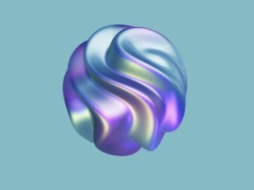 | `fomosphere` | `iridescent`    | Iridescent glass swirls, the only one with transmission |
| 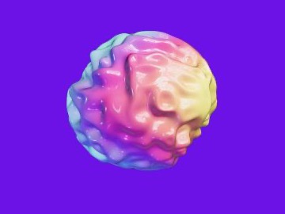 | `discobrain` | `rainbow`       | Rainbow brain folds, mirror glossy                      |
| 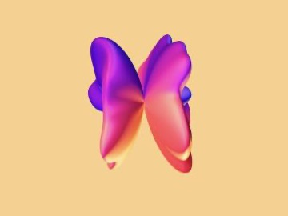   | `cyberfly`   | `rainbow`       | Two magenta and orange metal wings                      |
| 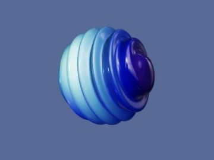 | `twistertoy` | `deep-ocean`    | Stacked blue rings                                      |
| 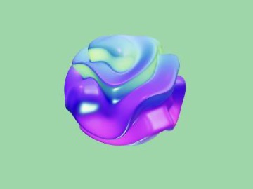   | `fungible`   | `cd`            | Purple and blue folded layers with mint highlights      |
| 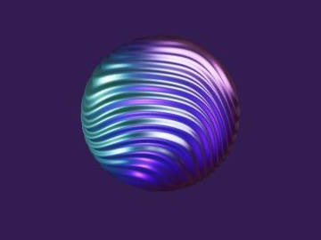  | `metalness`  | `cosmic-fusion` | Fine metal ripples, purple and teal                     |
| 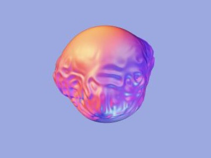    | `metagum`    | `halloween`     | Crinkled gum, orange to violet                          |
| 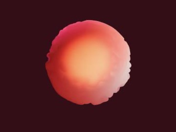    | `firefly`    | `passion`       | Soft matte coral glow                                   |
| 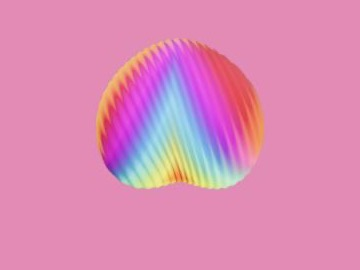     | `slinky`     | `pink-floyd`    | Matte rainbow ridges                                    |
| 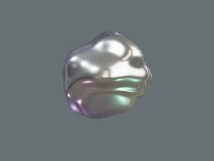     | `t-1000`     | `white`         | Liquid chrome                                           |
| 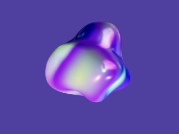    | `genesys`    | `hollogram`     | Holographic violet drop                                 |
| 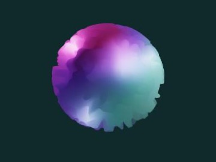  | `protocool`  | `cosmic-fusion` | Frosted pink and teal sphere, no environment map        |
| 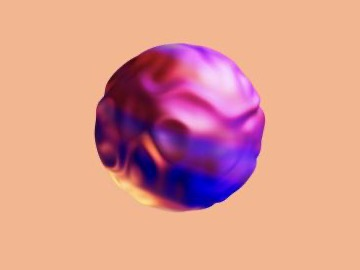  | `liquidity`  | `imaginarium`   | Purple and orange liquid metal                          |
| 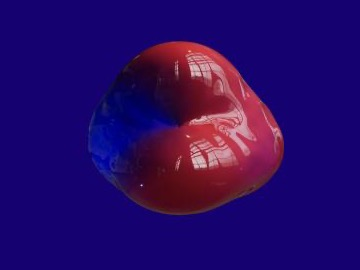    | `lipsync`    | `sunset-vibes`  | Glossy red lips, still goo under moving waves           |

To render a preset like the pictures, put the component on a page of its own with the Blobmixer camera and the preset background:

```astro
<Blobmixer
  preset="fungible"
  tint={1}
  cameraFov={40}
  cameraDistance={0.7}
  positionY={0.02}
  scale={0.14}
/>
```

## How it was rebuilt

The Blobmixer site publishes its source map, `https://blobmixer.14islands.com/static/js/main.538afb65.js.map`, so its React sources come back whole from it:

- `src/store.js` holds the 14 gallery blobs as query strings, the same ones the Blobmixer puts in its share links.
- `components/canvas/Blob/Blob.js` and `MagicalMaterial.js` hold the material: a `MeshPhysicalMaterial` with the displacement and the normals injected in its vertex shader. The GLSL is not in the source map but inlined in the bundle, `main.538afb65.js`.
- `components/canvas/Lights.js` places the spotlights, `DebugMaterialControls.js` names the gradients, `App.js` loads the environment map and `Scene.js` sets the background color.

The query strings became [blobmixer-presets.json](../src/data/blobmixer-presets.json) with every control filled in, taking the default of the Blobmixer where a preset leaves one out, as the Blobmixer does when it loads a blob. Twistertoy has a broken `ambient` key in its query string, so it takes the default ambient light, as on the Blobmixer. The values keep the Blobmixer units: the component turns light positions and distances, a tenth of a unit each, into radii of the blob, which is 0.14 in the Blobmixer scene.

The Blobmixer ran on three r143 through @react-three/fiber; the component runs on three 0.182 and makes up for what changed in between:

- Lights shine `Math.PI` times stronger, as three r143 spread them over a hemisphere.
- The fragment shader gets back the linear light falloff of r143, where three now falls off with the inverse square of the distance.
- The renderer tone maps with ACES Filmic, as @react-three/fiber did by default.

Three things are new: the gradient blends from the last one while the blob changes preset, `fixNormals` blends in instead of switching, and the sphere has half the rings on viewports up to 768px. The Blobmixer post-processing (bloom, noise, scanlines, vignette) is not ported: it is off unless a share link turns it on, and none of the gallery blobs does.

### Assets

- **Gradients**: the 12 the presets use, in [public/assets/blobmixer/gradients](../public/assets/blobmixer/gradients). The Blobmixer has 5 more that no gallery blob uses: `purple-rain`, `lucky-day`, `foil`, `sirens` and `synthwave`, under `static/media/` on its site if a remix needs them.
- **Environment map**: [Peppermint Powerplant](https://polyhaven.com/a/peppermint_powerplant) by Andreas Mischok, CC0 from Poly Haven, byte for byte the one the Blobmixer loads.
- **HDR loader**: [copy-vendor-assets.js](../scripts/copy-vendor-assets.js) copies the `HDRLoader` of three into `public/vendor`, pointing its `three` import at the vendor copy.

## License

The Blobmixer is licensed [CC BY-NC-SA 4.0](https://creativecommons.org/licenses/by-nc-sa/4.0/):

- **Non commercial**: fine for a personal portfolio.
- **Attribution**: the footer credits the Blobmixer, its license and the environment map whenever the blobmixer background shows.
- **Share alike**: the component, the presets and the gradients are shared under the same license.

## Known issues

- In light mode the white hero texts lose contrast over the light parts of a blob, like the yellow and green ridges of Slinky, and where the blob ends behind the tagline and the Maggioli Spa link.
- The shader is as heavy as the Blobmixer one: fine on a desktop, not measured on a real phone yet.
